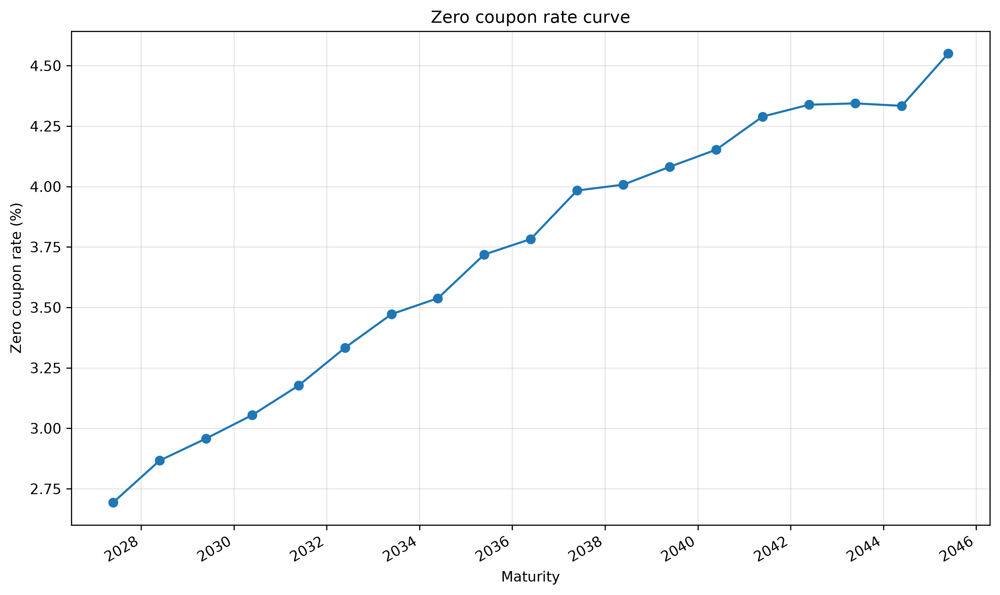
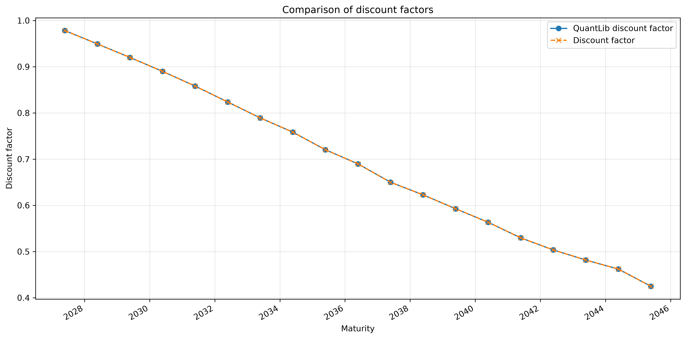
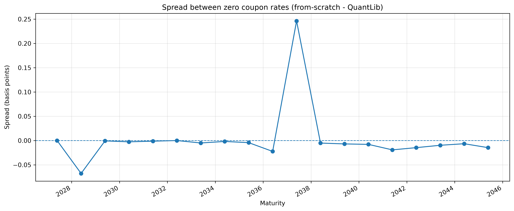

# Zero-Coupon Yield Curve Bootstrap: French OATs and OIS (€STR, SOFR)

## Overview

This project builds zero-coupon curves **from scratch** and validates each one against an independent **QuantLib** benchmark, on two kinds of instruments:

- **French government bonds (OATs)**: 19 bonds maturing between 2027 and 2045, valued on 2026-07-29 (public data, included);
- **Overnight indexed swaps (OIS)** on €STR and SOFR, from 1 week to 50 years, on 7 valuation dates between 2021 and 2026 (Bloomberg data, *not* included).

It started as a personal summer project alongside John Hull's *Options, Futures, and Other Derivatives*, to understand how discount and zero-coupon curves are built and how much market conventions matter. The OIS extension adds what the bond case did not need: interpolation between pillars, a root-finding step, and per-index calendars.

The zero-coupon curves are the input of my [Nelson-Siegel-Svensson calibration project](https://github.com/Target-Justin/nelson-siegel-svensson-oat-calibration).

## Highlights

- **OAT bootstrap**: the from-scratch curve matches QuantLib within **0.25 bp** at every maturity, and within 0.025 bp at all but two of them.
- **OIS bootstrap**: on all 14 curves (2 indices × 7 dates, 32 pillars each), the from-scratch zero rates match QuantLib's `OISRateHelper` curve within **10⁻⁷ bp**, and the discount factors within 3·10⁻¹³.

## Contents

- [OAT Bootstrap](#oat-bootstrap)
- [OIS Bootstrap](#ois-bootstrap)
- [Project Structure](#project-structure)
- [Usage](#usage)
- [Data Availability](#data-availability)
- [Limitations](#limitations)
- [Requirements](#requirements)
- [References](#references)

## OAT Bootstrap

### Data

- **Agence France Trésor**: bond characteristics (ISIN, maturity, coupon, issue and accrual start dates, frequency, day count): https://www.aft.gouv.fr/fr/encours-detaille-oat
- **Euronext**: clean closing prices on 2026-07-29: https://www.euronext.com/en

All inputs are in `data/raw/bonds/dataset.csv`.

### Conventions

| Item | Convention |
|---|---|
| Valuation date | 2026-07-29 |
| Settlement | T+2 business days, TARGET calendar |
| Coupon schedule | generated backward from maturity, unadjusted dates, no holiday calendar |
| Coupons | fixed amounts: nominal × coupon rate / frequency |
| Accrued interest | day count of each bond (ACT/ACT) |
| Curve time | ACT/ACT ISDA, from the settlement date |
| Zero rates | continuously compounded |

### Method

The settlement date is the reference date for accrued interest and for all future cash flows:

```text
Euronext clean price
        │
        ▼
Valuation date (T) ── + 2 business days (TARGET) ──► Settlement date
                                                          │
                                   ┌──────────────────────┴──────────────────────┐
                                   ▼                                             ▼
                      Accrued interest up to settlement             Future cash flows after settlement
                                   │                                             │
                                   └──────────────────────┬──────────────────────┘
                                                          ▼
                                    Dirty price ──► Sequential bootstrap ──► Discount factors ──► Zero rates
```

1. **Cash flows** (`scripts/bonds/cashflow.py`): coupons and principal paid after settlement.
2. **Dirty prices** (`scripts/bonds/dirty_price.py`): clean price plus the coupon accrued between the last coupon date and settlement.
3. **Sequential bootstrap** (`scripts/bonds/bootstrap.py`): bonds are sorted by maturity, and each one gives the discount factor of its last payment date once all its earlier payment dates are known:

   ```text
   DF(t_n) = [Dirty price - Σ_{i<n} CF(t_i) · DF(t_i)] / CF(t_n)
   ```

   No interpolation is used: every intermediate payment date must coincide with a maturity already bootstrapped. To meet this condition, the maturities of the 2037, 2039, 2041 and 2044 OATs were shifted by one month. This simplification may have a small effect on the curve.
4. **Zero rates** (`scripts/bonds/zero_rates.py`): `r(t) = -ln(DF(t)) / t`, with `t` in ACT/ACT ISDA from settlement.

### QuantLib benchmark

`scripts/bonds/quantlib/quantlib_bootstrap.py` builds an independent curve with `FixedRateBondHelper` and `PiecewiseLogLinearDiscount` (log-linear interpolation of discount factors), from the same clean prices and conventions.

### Results

The two curves agree within **0.25 bp** at every maturity. Two points stand out: 2037 (+0.25 bp, one of the four maturities shifted by one month) and 2028 (−0.07 bp). Everywhere else the difference stays below 0.025 bp. It does not grow with maturity. The precise source of the two larger deviations has not been identified. QuantLib interpolates between pillars while the from-scratch bootstrap does not need to, which is a plausible lead. Other QuantLib interpolations (`PiecewiseLogCubicDiscount`, `PiecewiseLinearZero`, `PiecewiseCubicZero`) were also tested.







## OIS Bootstrap

### Data

Bloomberg curve exports for €STR and SOFR OIS, on 2021-06-30, 2022-06-30, 2022-12-30, 2023-03-31, 2023-10-31, 2024-12-30 and 2026-10-02. Each file holds 32 swaps from 1 week to 50 years, plus the overnight rate, which is excluded from the bootstrap. The quotes are not published: see [Data Availability](#data-availability).

Expected input: one CSV file per date, `data/raw/ois/<ESTR|SOFR>/<YYYY-MM-DD>.csv`, with at least the columns `Ticker`, `Term`, `Unit` (`DY`, `WK`, `MO`, `YR`), `Bid`, `Ask` (in %), `Daycount` and `Freq` (`0` for the overnight rate).

### Conventions

| Item | €STR | SOFR |
|---|---|---|
| Calendar | TARGET | US SOFR |
| Settlement | T+2 business days | T+2 business days |
| Fixed leg | annual payments (one payment up to 1 year), ACT/360 | same |
| Schedule | generated forward from settlement, Modified Following | same |
| Curve time | ACT/360, from settlement | same |
| Quote used | mid = (bid + ask) / 2 | same |

Generating the schedule forward from settlement means that an 18-month swap pays after 12 months and then after a short 6-month period.

### Method

At inception, an OIS is worth zero. Its floating leg, compounded overnight and discounted on the same curve, is worth par. The swap can therefore be priced as a **par bond** paying the fixed rate `K` (the mid quote):

```text
Σ_i K · τ_i · DF(t_i) + DF(t_n) = 1        τ_i: accrual fraction (ACT/360) of period i
```

1. **Cash flows** (`scripts/ois/cashflow.py`): the fixed-leg schedule of each swap, with the nominal repaid at maturity.
2. **Pillars** (`scripts/ois/pillar.py`): swaps are sorted by maturity, and each maturity is a pillar.
3. **Bootstrap** (`scripts/ois/bootstrap.py`, `scripts/ois/pricing.py`): for each pillar, the discount factor at maturity is the root of the swap NPV (present value of the fixed leg plus nominal, minus nominal), found with `scipy.optimize.brentq` on `[10⁻⁶, 2]` with `xtol = 10⁻¹⁴`. Unlike the bond case, long swaps have annual payment dates that are not pillars (for example years 13 and 14 of a 15-year swap when the previous pillar is 12 years). Their discount factors are interpolated **log-linearly** between the last known pillar and the maturity, as a function of the unknown maturity discount factor. They are therefore solved jointly with it inside the root-finding.
4. **Zero rates** (`scripts/ois/zero_rates.py`): `r(t) = -ln(DF(t)) / t`, with `t` in ACT/360 from settlement, at each pillar.

### QuantLib benchmark

`scripts/ois/quantlib/quantlib_bootstrap.py` builds an independent curve with `OISRateHelper` (index `Estr()` or `Sofr()`, same calendars, forward schedule) and `PiecewiseLogLinearDiscount`, from the same mid quotes.

### Results

On all 14 curves, the from-scratch and QuantLib curves agree within **10⁻⁷ bp** on zero rates and **3·10⁻¹³** on discount factors at every pillar, which is numerical precision. Unlike the OAT case, this agreement is expected: both curves use the same instruments, the same conventions and the same log-linear interpolation of discount factors. It confirms that the schedules, calendars, day counts and interpolation are implemented consistently with QuantLib.

Plots and CSV outputs of the OIS bootstrap are not published, because they would reveal the Bloomberg quotes.

### Output for the NSS project

`run_ois()` also gathers all the curves in a single long-format file, `results/ois/zero_rate.csv`, with one row per curve, date and pillar: `Curve`, `EvaluationDate`, `SettlementDate`, `Ticker`, `Maturity`, `TimeToMaturity`, `DiscountFactor`, `ZeroCouponRate`, `ZeroCouponRatePct`, `Bid`, `Ask` and `BidAskSpreadBp`. This file is the OIS input of the [Nelson-Siegel-Svensson calibration project](https://github.com/Target-Justin/nelson-siegel-svensson-oat-calibration).

## Project Structure

```text
main.py                                   # entry point: python main.py [bonds|ois|all]
config.py                                 # paths and market conventions
scripts/
├── bonds/
│   ├── pipeline.py                       # run_bonds
│   ├── cashflow.py                       # coupon and principal cash flows
│   ├── dirty_price.py                    # accrued interest and dirty prices
│   ├── bootstrap.py                      # sequential bootstrap
│   ├── zero_rates.py
│   ├── bootstrap_validation.py           # comparison with QuantLib
│   └── quantlib/
│       └── quantlib_bootstrap.py         # FixedRateBondHelper benchmark
├── ois/
│   ├── pipeline.py                       # run_ois (all dates, gathered output file)
│   ├── mid.py                            # mid quotes, overnight rate excluded
│   ├── cashflow.py                       # fixed-leg schedules
│   ├── pillar.py                         # pillar ordering and root-finding
│   ├── pricing.py                        # swap NPV and log-linear interpolation
│   ├── bootstrap.py
│   ├── zero_rates.py
│   ├── bootstrap_validation.py           # comparison with QuantLib
│   └── quantlib/
│       └── quantlib_bootstrap.py         # OISRateHelper benchmark
└── common/
    ├── common.py                         # date conversions, day counts, interpolation
    └── plots.py
data/
├── raw/bonds/dataset.csv                 # OAT inputs (included)
├── raw/ois/ESTR/, raw/ois/SOFR/          # OIS quotes (Bloomberg, not included)
└── processed/bonds/                      # cash flows, dirty prices, discount factors
results/
├── bonds/                                # OAT curve, QuantLib benchmark, comparison, plots
└── ois/                                  # OIS outputs (not included)
```

## Usage

```bash
git clone https://github.com/Target-Justin/Zero-Coupon-Yield-Curve-Bootstrap.git
cd Zero-Coupon-Yield-Curve-Bootstrap
pip install -r requirements.txt

python main.py bonds    # OAT bootstrap: reproduces every published result
python main.py ois      # OIS bootstrap: requires the files described in "OIS Bootstrap > Data"
python main.py          # both (the OIS step is skipped if no OIS file is found)
```

Market conventions (calendars, settlement lags, schedule rules, day counts) and solver settings are centralized in `config.py`.

## Data Availability

- **OAT data** come from public sources (AFT, Euronext) and are included.
- **OIS data** come from Bloomberg and cannot be redistributed. The raw quotes and everything derived from them (cash flows, discount factors, zero rates, plots) are excluded by `.gitignore`: `data/raw/ois/*/*.csv`, `data/processed/ois/` and `results/ois/`. The folder structure is kept with `.gitkeep` files, so you can drop your own exports in `data/raw/ois/ESTR/` and `data/raw/ois/SOFR/`.

## Limitations

- **OAT maturities adjusted**: four maturities were shifted by one month to keep the bond bootstrap free of interpolation.
- **OIS treated as par bonds**: this relies on discounting on the same curve as the one used for projection (single-curve OIS discounting). Payment lags of the floating leg and convexity effects are ignored.
- **No interpolation choice studied for OIS**: only log-linear interpolation of discount factors is implemented, which gives piecewise flat forward rates between pillars.
- **Data check**: the €STR export labelled 2021-06-30 has rate levels inconsistent with that date and will be re-extracted. It does not affect the validation against QuantLib, which uses the same quotes and dates on both sides.

## Requirements

Developed and tested with Python 3.14:

```text
numpy==2.5.1
scipy==1.18.0
pandas==3.0.5
QuantLib==1.43
matplotlib==3.11.1
```

Install with `pip install -r requirements.txt`.

## References

- Hull, J. C. *Options, Futures, and Other Derivatives*, 11th edition. ISBN 978-1-292-41065-4.
- Ametrano, F. M., & Bianchetti, M. (2013). *Everything You Always Wanted to Know About Multiple Interest Rate Curve Bootstrapping but Were Afraid to Ask*. SSRN Working Paper.
- QuantLib documentation: https://www.quantlib.org
